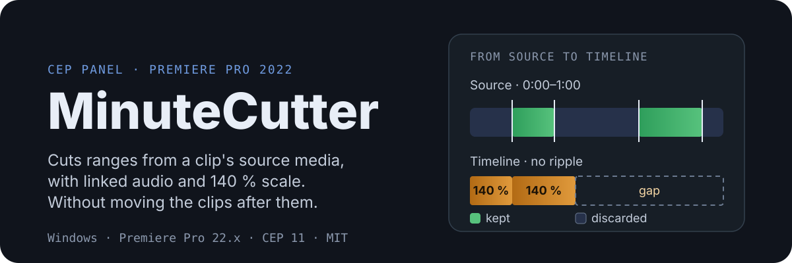
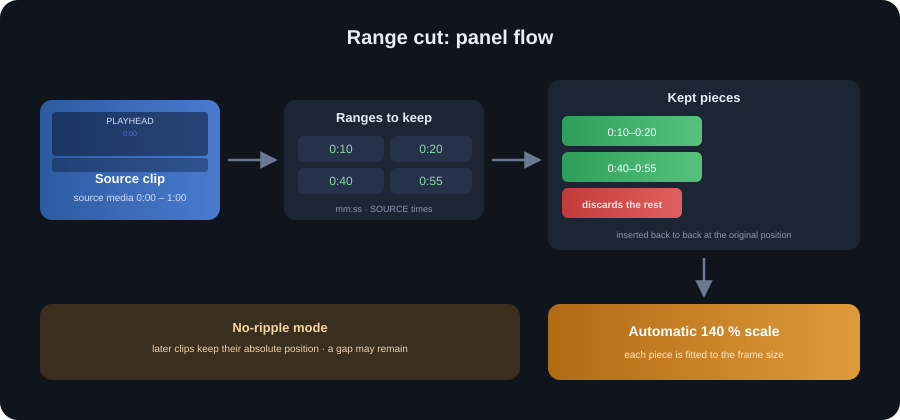

<p align="center"></p>

<p align="center"><a href="README.md">Español</a> · <b>English</b></p>

[](https://github.com/Eduardo12Pacheco/minutecutter-panel-premiere/actions/workflows/ci.yml) [](LICENSE)

A CEP panel for **Premiere Pro 2022** that cuts a video clip **from its source media** (source times, not timeline times) in one action. It cuts the video and its linked audio, keeps the chosen ranges as contiguous pieces, applies **140% scale**, and **does not move the material after the cut**.

| | |
|---|---|
| **Current stable** | `v1.1.0`: no-ripple mode |
| **Previous version** | `v1.0.0`: cut with gap closing (ripple) |
| **Platform** | Windows · Premiere Pro 22.x (tested on 22.5.0) · CEP 11 |
| **License** | MIT |

## What it does

- **Source times:** `Inicio` (start) and `Fin` (end) are measured on the clip's source media, not on its position in the timeline. `0:10` → `0:20` keeps seconds 10 to 20 of the media, wherever the clip starts.
- **Linked audio:** audio attached to the selected video is cut along with it.
- **140% scale:** each piece is fitted to the frame size and gets `Scale = 140`.
- **No ripple:** later clips keep their absolute position. A gap may remain after the last piece.

## How it works



1. Creates one subclip for each kept range.
2. Removes the original clip, together with its linked audio.
3. Inserts the subclips back to back at the original position and applies 140% scale. Later clips do not move.

## Quick start

Run these steps from the root of the cloned repository. Close Premiere Pro before you start.

1. Copy the **contents** of `extension\` into the user extensions folder:

   ```powershell
   $src = Join-Path (Get-Location) "extension"
   $dest = "$env:APPDATA\Adobe\CEP\extensions\com.pelot.minutecutter"
   New-Item -ItemType Directory -Path $dest -Force | Out-Null
   Copy-Item -Path (Join-Path $src "*") -Destination $dest -Recurse -Force
   ```

2. Enable unsigned CEP extensions. This is needed only once:

   ```powershell
   reg add "HKCU\Software\Adobe\CSXS.11" /v PlayerDebugMode /t REG_SZ /d 1 /f
   ```

3. Reopen Premiere Pro and open **Window > Extensions > Minute Cutter**.

**Expected result:** the panel shows `Clip: <name>  —  Duración: <mm:ss>` and the **Cortar** (Cut) button enabled. The panel UI is in Spanish.

The full guide, with checks, installation for AI agents and how to return to an earlier version, is in [docs/instalacion.md](docs/instalacion.md) (Spanish).

## Limitations

- **Platform:** Windows, Premiere Pro 22.x and CEP 11. Other versions have not been verified.
- **1x speed only:** clips with a speed other than 100%, and reversed clips, are not supported.
- **No ripple:** the material after the cut does not move, so a gap may remain. If you need it to shift, use `v1.0.0`.
- **Build dependency:** Premiere Pro is closed software, and the cut uses ExtendScript methods (creating subclips, removing and inserting clips) that may vary between builds. Always test on a copy of the project.

Details, panel messages and troubleshooting are in [docs/uso.md](docs/uso.md) (Spanish).

## Documentation

All guides are in Spanish:

- [Installation for people and agents](docs/instalacion.md)
- [Usage, time format and troubleshooting](docs/uso.md)
- [Development, tests and continuous integration](docs/desarrollo.md)

## Development

```bash
npm test
```

Runs the no-ripple behavior harness (25 assertions) with Node.js 22. Details in [docs/desarrollo.md](docs/desarrollo.md).

## License

The code is distributed under the MIT license; the full text is in [LICENSE](LICENSE).

"Adobe", "Premiere Pro" and "CEP" are trademarks of Adobe Inc. This project is not affiliated with or endorsed by Adobe.
