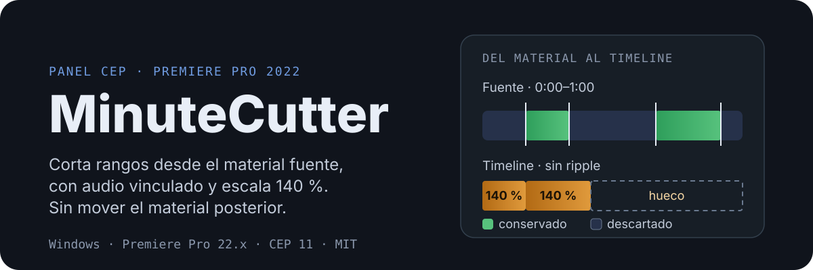
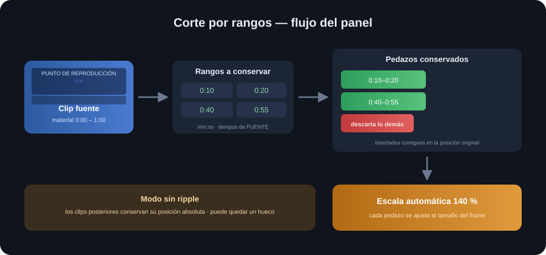

<p align="center"></p>

<p align="center"><b>Español</b> · <a href="README.en.md">English</a></p>

[](https://github.com/Eduardo12Pacheco/minutecutter-panel-premiere/actions/workflows/ci.yml) [](LICENSE)

Panel CEP para **Premiere Pro 2022** que corta un clip de video **desde su material fuente** (tiempos de fuente, no de timeline) en una sola acción. Corta el video y el audio vinculado, conserva los rangos elegidos como pedazos contiguos, les aplica **escala 140 %** y **no mueve el material posterior**.

| | |
|---|---|
| **Versión estable** | `v1.1.0`: modo sin ripple |
| **Versión anterior** | `v1.0.0`: corte con cierre de hueco (ripple) |
| **Plataforma** | Windows · Premiere Pro 22.x (probado en 22.5.0) · CEP 11 |
| **Licencia** | MIT |

## Qué hace

- **Tiempos de fuente:** `Inicio` y `Fin` se miden sobre el material del clip, no sobre su posición en el timeline. `0:10` → `0:20` conserva los segundos 10 a 20 del material, sin importar dónde empiece el clip.
- **Audio vinculado:** el audio acoplado al video seleccionado se corta junto con él.
- **Escala 140 %:** cada pedazo se ajusta al tamaño del frame y recibe `Scale = 140`.
- **Sin ripple:** los clips posteriores conservan su posición absoluta. Puede quedar un hueco después del último pedazo.

## Cómo funciona



1. Crea un subclip por cada rango conservado.
2. Quita el clip original, con su audio vinculado.
3. Inserta los subclips contiguos en la posición original y aplica la escala 140 %. Los clips posteriores no se mueven.

## Inicio rápido

Ejecuta estos pasos desde la raíz del repositorio clonado. Cierra Premiere Pro antes de empezar.

1. Copia el **contenido** de `extension\` a la carpeta de extensiones de usuario:

   ```powershell
   $src = Join-Path (Get-Location) "extension"
   $dest = "$env:APPDATA\Adobe\CEP\extensions\com.pelot.minutecutter"
   New-Item -ItemType Directory -Path $dest -Force | Out-Null
   Copy-Item -Path (Join-Path $src "*") -Destination $dest -Recurse -Force
   ```

2. Habilita las extensiones CEP sin firmar. Solo hace falta una vez:

   ```powershell
   reg add "HKCU\Software\Adobe\CSXS.11" /v PlayerDebugMode /t REG_SZ /d 1 /f
   ```

3. Reabre Premiere Pro y abre **Window > Extensions > Minute Cutter**.

**Resultado esperado:** el panel muestra `Clip: <nombre>  —  Duración: <mm:ss>` y el botón **Cortar** habilitado.

La guía completa, con verificaciones, instalación para agentes y cómo volver a una versión anterior, está en [docs/instalacion.md](docs/instalacion.md).

## Limitaciones

- **Plataforma:** Windows, Premiere Pro 22.x y CEP 11. No se verificó en otras versiones.
- **Solo velocidad 1x:** no se admiten clips con velocidad distinta de 100 % ni clips en reversa.
- **Sin ripple:** el material posterior no se mueve, así que puede quedar un hueco. Si necesitas que se corra, usa `v1.0.0`.
- **Dependencia del build:** Premiere Pro es software cerrado y el corte usa métodos de ExtendScript (crear subclips, quitar e insertar clips) que pueden variar entre builds. Prueba siempre en una copia del proyecto.

Detalle, mensajes del panel y solución de problemas en [docs/uso.md](docs/uso.md).

## Documentación

- [Instalación para personas y agentes](docs/instalacion.md)
- [Uso, formato de tiempos y solución de problemas](docs/uso.md)
- [Desarrollo, pruebas e integración continua](docs/desarrollo.md)

## Desarrollo

```bash
npm test
```

Ejecuta el harness de comportamiento sin ripple (25 aserciones) con Node.js 22. Detalles en [docs/desarrollo.md](docs/desarrollo.md).

## Licencia

El código se distribuye bajo la licencia MIT; el texto completo está en [LICENSE](LICENSE).

"Adobe", "Premiere Pro" y "CEP" son marcas de Adobe Inc. Este proyecto no está afiliado ni respaldado por Adobe.
