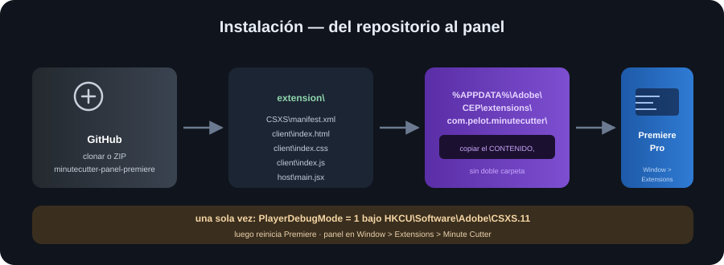

# Instalación de MinuteCutter

Guía completa para instalar el panel en Premiere Pro 2022 (Windows). Para la versión corta, vuelve al [README](../README.md).

<p align="center"></p>

## Requisitos

- Windows.
- Adobe Premiere Pro 22.x. El manifest declara `[22.0, 22.9]`; el autor lo probó en 22.5.0.
- CEP 11 (`RequiredRuntime Name="CSXS" Version="11.0"`).

## Instalación para personas

### 1. Obtener el código

**Opción A: clonar con git**

```powershell
git clone https://github.com/Eduardo12Pacheco/minutecutter-panel-premiere.git
cd minutecutter-panel-premiere
```

**Opción B: descargar el ZIP (sin git)**

1. Entra a `https://github.com/Eduardo12Pacheco/minutecutter-panel-premiere`.
2. Pulsa **Code ▾** y luego **Download ZIP**.
3. Descomprime el archivo. Queda una carpeta como `minutecutter-panel-premiere-main\`. Usa esa carpeta como raíz en los pasos siguientes.

### 2. Instalar en Premiere

> **Atención con la doble carpeta:** copia el **contenido** de `extension\`, no la carpeta `extension` en sí. Si copias la carpeta completa, queda `...\com.pelot.minutecutter\extension\...` y el panel no aparece. El manifest debe quedar en `%APPDATA%\Adobe\CEP\extensions\com.pelot.minutecutter\CSXS\manifest.xml`.

Ejecuta el siguiente bloque desde la **raíz del proyecto**:

```powershell
$src = Join-Path (Get-Location) "extension"
$dest = "$env:APPDATA\Adobe\CEP\extensions\com.pelot.minutecutter"
New-Item -ItemType Directory -Path $dest -Force | Out-Null
Copy-Item -Path (Join-Path $src "*") -Destination $dest -Recurse -Force
```

**Verificación:** debe devolver `True`:

```powershell
Test-Path "$env:APPDATA\Adobe\CEP\extensions\com.pelot.minutecutter\CSXS\manifest.xml"
```

Estructura instalada correcta:

```
%APPDATA%\Adobe\CEP\extensions\com.pelot.minutecutter\
├── CSXS\manifest.xml
├── client\index.html, index.css, index.js
└── host\main.jsx
```

### 3. Habilitar PlayerDebugMode (una sola vez)

```
HKEY_CURRENT_USER\Software\Adobe\CSXS.11
Valor: PlayerDebugMode  (REG_SZ)  =  1
```

**Opción A: `reg.exe`**

```powershell
reg add "HKCU\Software\Adobe\CSXS.11" /v PlayerDebugMode /t REG_SZ /d 1 /f
```

**Opción B: PowerShell**

```powershell
New-Item -Path "HKCU:\Software\Adobe\CSXS.11" -Force | Out-Null
Set-ItemProperty -Path "HKCU:\Software\Adobe\CSXS.11" -Name "PlayerDebugMode" -Value "1"
```

**Verificación:** debe devolver el valor `1`:

```powershell
Get-ItemProperty -Path "HKCU:\Software\Adobe\CSXS.11" -Name "PlayerDebugMode"
```

### 4. Reiniciar Premiere

1. Premiere debe estar **completamente cerrado** durante la copia y el registro. No basta con cerrar la ventana del proyecto.
2. Abre Premiere Pro.
3. Abre **Window > Extensions > Minute Cutter** (el manifest declara `AutoVisible` en `true`).

## Instalación para agentes

Instrucciones literales para que un agente de IA instale el panel en una máquina nueva:

1. **Clonar o descargar** el repositorio: `git clone https://github.com/Eduardo12Pacheco/minutecutter-panel-premiere.git`. También sirve el ZIP, usando la carpeta descomprimida como raíz del proyecto.
2. **Leer esta guía completa**, en especial *Requisitos* e *Instalación para personas*.
3. **Ejecutar el checklist** de verificación:
   - [ ] Premiere Pro cerrado por completo.
   - [ ] Contenido de `extension\` copiado a `%APPDATA%\Adobe\CEP\extensions\com.pelot.minutecutter\` (**sin doble carpeta**).
   - [ ] `Test-Path "$env:APPDATA\Adobe\CEP\extensions\com.pelot.minutecutter\CSXS\manifest.xml"` devuelve `True`.
   - [ ] `PlayerDebugMode = 1` bajo `HKCU\Software\Adobe\CSXS.11`.
   - [ ] Premiere reiniciado; panel visible en Window > Extensions.
4. **Validar el manifest:** `extension/CSXS/manifest.xml` debe declarar `Host Name="PPRO" Version="[22.0,22.9]"` y `RequiredRuntime Name="CSXS" Version="11.0"`, con `ExtensionBundleId="com.pelot.minutecutter"`.
5. **Instalar** con el bloque de PowerShell de *Instalar en Premiere* (pasos 2 y 3), ejecutado desde la raíz del proyecto.
6. **No tocar archivos fuera del destino:** no modificar `%APPDATA%\Adobe\CEP\extensions\com.pelot.minutecutter\` ni el registro más allá de `CSXS.11\PlayerDebugMode`. No escribir en la carpeta del proyecto ni en el repositorio durante la instalación.

## Volver a una versión anterior

| Tag | Commit | Descripción |
|---|---|---|
| `v1.1.0` | `35f517b` | Estable actual: modo sin ripple |
| `v1.0.0` | `bc152bf` | Anterior: corte con cierre de hueco (ripple) |

```bash
git checkout v1.0.0
```

Después del cambio, repite el paso de copia de `extension\` a `%APPDATA%\Adobe\CEP\extensions\com.pelot.minutecutter` y reinicia Premiere. Para volver a la rama principal, ejecuta `git checkout main`.
